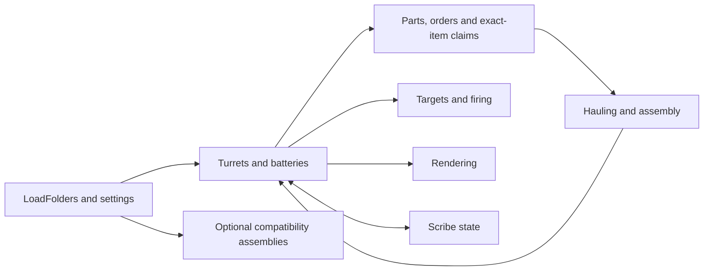

# Modular Turrets

## Features
- Modular turrets with interchangeable weapons and upgradeable modules.
- Modular batteries with wireless power, generation, and storage upgrades.
- Paragon upgrades, advanced combat systems, and optional mod integrations.

Modular turrets and batteries for **RimWorld 1.7/Waylith**. Requires **Harmony**.

**0.1.1 · Hakurua · MIT**

## Install

- Use the runtime release's `ModularTurrets` folder as Workshop content or place it under the game's `Mods` directory. Load Harmony before Modular Turrets. Close the game before replacing an installed version.
- [Subscribe on Steam Workshop](https://steamcommunity.com/sharedfiles/filedetails/?id=3838344308)

## Build

Requires the .NET 10 SDK, PowerShell 7 and local game/Harmony reference DLLs. From the repository root:

```powershell
./ModularTurrets/Build.ps1 -GameRoot 'D:\Games\RimWorld' `
    -HarmonyPath 'D:\Mods\Harmony\1.7\Assemblies\0Harmony.dll'
```

Core builds to `ModularTurrets/Assemblies/ModularTurrets.dll`. Use the build script's `-With...` options for optional integrations. CE, Logical Floors and VisibleWealth need their matching local reference DLLs; their path arguments are declared in `Build.ps1`. `LoadFolders.xml` controls runtime activation. Game and dependency DLLs are not bundled.

`ModularTurrets/Package.ps1` creates Runtime/Source ZIPs in `dist`. Optional adapters must be built before packaging to include them. `Install.ps1 -GameRoot ...` updates a local installation.

## Source map



Read [settings](ModularTurrets/Source/Settings/ModularTurretsMod.cs), the [turret](ModularTurrets/Source/Turrets/Building_ModularTurret.cs) and [battery](ModularTurrets/Source/Batteries/Building_ModularBattery.cs), then their feature files. [Part state](ModularTurrets/Source/Modules/CompTurretPart.cs), [assembly jobs](ModularTurrets/Source/Construction), [combat](ModularTurrets/Source/Combat), [rendering](ModularTurrets/Source/Rendering) and [adapters](ModularTurrets/Compat) are grouped by responsibility.

Preserve saved type names, DefNames, Scribe keys and physical-part ownership. Keep partial-file initialization order in `CompileOrder.props`; private nested types stay with their owner. Runtime caches and worker snapshots are rebuilt rather than saved.

## Combat Extended

Some basic compatibility patches have been implemented for Combat Extended (CE). However, this does not mean the mod is fully compatible with CE.

These patches are intended only to ensure basic playability, and numerous bugs or unexpected issues may still occur.

As the mod author does not personally play with CE, CE compatibility may be more prone to bugs and receive less extensive testing than the vanilla (Core) version.

## Translations and license

See [Languages/README.md](ModularTurrets/Languages/README.md) to add a language or contribute a translation.

Project-authored material is licensed under the [MIT License](LICENSE) by Hakurua ([GitHub: @hakurua-ichi](https://github.com/hakurua-ichi)). Retain [NOTICE.txt](ModularTurrets/NOTICE.txt) for the publisher acknowledgement and third-party licensing information.
